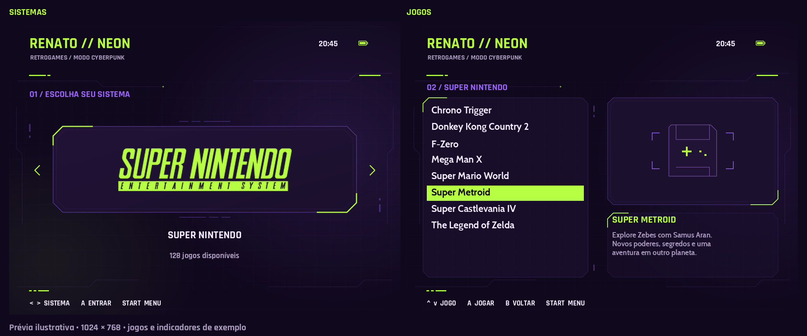

# RENATO // NEON

Tema visual cyberpunk para EmulationStation / ArkOS com estética neon em verde e roxo, foco em layout 4:3 e navegação com visual moderno e limpo.



## Introdução

O tema `RENATO // NEON` foi desenvolvido para criar uma interface de seleção de sistemas e jogos com visual futurista, alta legibilidade e organização inspirada em consoles retrô e ambientes cyberpunk.

Ele inclui:

- tela de sistemas com carousel centralizado;
- lista de jogos em visual `Basic`, `Detailed` e `Video`;
- fundo com identidade visual neon;
- logo de sistema por catálogo;
- metadata de jogos com imagem, descrição e vídeo;
- suporte a relógio, bateria e ícone de rede quando disponibilizado pelo firmware.

## Estrutura do projeto

- `theme.xml` — configuração principal do tema.
- `splash.xml` — estilos da tela de carregamento.
- `_inc/` — fontes, sons, assets visuais, logos e imagens de apoio.
- `scripts/` — scripts para geração de assets e pacote do tema.
- `dist/` — pacote final empacotado para instalação.
- `docs/` — prévias e documentação visual.

## Requisitos

- EmulationStation com suporte a temas do ArkOS.
- Compatibilidade com layouts em 4:3.
- Arquivos do tema em pasta `themes` no dispositivo de armazenamento do console.

## Instalação

1. Faça o download ou use o pacote em `dist/RENATO-THEME.zip`.
2. Extraia o conteúdo na pasta `themes` do seu cartão/partição de ROMs.
3. O resultado esperado é algo como:

```text
themes/
└── RENATO-THEME/
    ├── theme.xml
    ├── splash.xml
    └── _inc/
```

4. No console, vá em:

```text
START → UI Settings → Theme → RENATO-THEME
```

5. Escolha a visualização desejada: `Basic`, `Detailed` ou `Video`.

## Personalização

Os principais pontos de ajuste estão em:

- `theme.xml` — textos, cores, fontes, tamanhos e posições;
- `splash.xml` — paleta da tela de inicialização;
- `_inc/neon/` — fundos e recursos visuais;
- `_inc/neon/logos/` — logos dos sistemas;
- `_inc/fonts/` — fontes utilizadas.

## Geração de assets

Se você alterar SVGs, fundos ou logos, use os scripts do projeto para rebuildar os arquivos de distribuição:

```bash
python3 scripts/build_assets.py
python3 scripts/preview.py
python3 scripts/package.py
```

Esses comandos geram os recursos finais e o zip de instalação para o tema.

## Observações

- O tema foi pensado para o uso em telas 4:3.
- A aparência final pode variar conforme o firmware do console e os recursos disponíveis do sistema.
- O relógio, bateria e indicação de rede dependem do suporte do ambiente do ArkOS/EmulationStation.

## Créditos

- Base e recursos inspirados em temas de referência do ecossistema EmulationStation / ArkOS.
- Fontes incluídas:
  - Rajdhani Bold
  - Cabin Bold
- Licenças das fontes estão em:
  - `_inc/fonts/Rajdhani-OFL.txt`
  - `_inc/fonts/Cabin-OFL.txt`

## Referências

- [Wiki de temas do ArkOS](https://github.com/christianhaitian/arkos/wiki/Themes)
- [EmulationStation (ArkOS fork)](https://github.com/christianhaitian/EmulationStation-fcamod)
